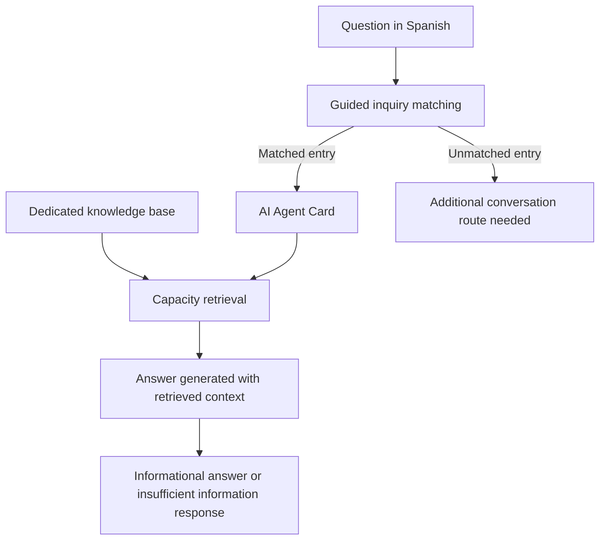
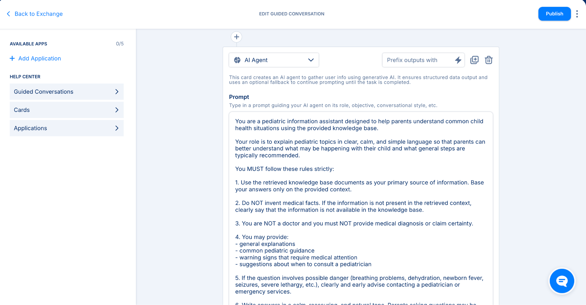
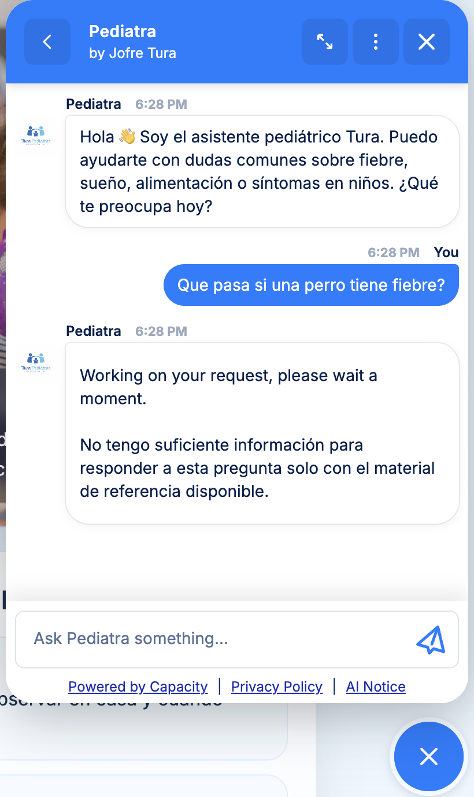

# Pediatric RAG Assistant

An academic prototype built by **Jofre Tura Centelles** with **Capacity Console** for the Technological Trends course at La Salle Campus Barcelona, April 2026.

I configured a dedicated knowledge base, a guided conversation and an AI Agent Card to explore how retrieved information can support answers to common questions from first-time parents. I tested Spanish queries, adjusted the prompt and documented the findings.

This is an educational, informational prototype. Clinical validation remains outstanding.

## What I built

- A knowledge base organised by topic, including fever, hydration, feeding, sleep and warning signs.
- Concierge access restricted to the dedicated project knowledge base.
- A guided entry point for fever-related questions, followed by answers generated from retrieved content.
- A web concierge and a simple HTML integration.
- Qualitative evaluation of answer clarity, follow-up questions and behaviour outside the intended scope.

Capacity provides the managed retrieval and generation components. My work focused on the knowledge-base organisation, access configuration, conversation design, prompt configuration, testing and technical report.

## How the configured flow works

## Recorded evidence

The screenshots below come from the original academic report. They show the configuration and recorded test behaviour.

### Agent configuration

### Boundary test

A question about a dog triggered an insufficient-information response. This provides one recorded example of how the assistant handled a query outside its intended pediatric scope.

Additional response samples and their limitations are described in the [evaluation](docs/evaluation.md).

## Findings

The academic report describes clearer, shorter responses and earlier follow-up questions after prompt refinement. These are qualitative observations. The screenshots contain partial responses and their placement does not establish a reliable before-and-after sequence, so the evidence supports response samples and a reported conclusion.

I also identified a coverage limitation. A broad query can miss the configured inquiry patterns, even when its topic is relevant. The next iteration would expand the entry points and evaluate an open-ended fallback.

## Explore the project

- [Technical case study](docs/case-study.md)
- [Evaluation and recorded test cases](docs/evaluation.md)
- [Knowledge-base design and source provenance](docs/knowledge-base.md)
- [Reconstructed prompt template](prompts/assistant-template.md)
- [Configurable web integration](demo/index.html)
- [Public project report](docs/project-report.pdf)

## Reproduce the approach

1. Create a dedicated Capacity knowledge base and organise reviewed content by topic.
2. Record source provenance and document versions using the [knowledge-base guide](docs/knowledge-base.md).
3. Create a dedicated concierge and configure its access to that knowledge base.
4. Configure inquiry variants and an AI Agent Card, adapting the [prompt template](prompts/assistant-template.md).
5. Run and record the cases described in the [evaluation](docs/evaluation.md).
6. Open `demo/index.html` locally. Set its `conciergeToken` to the token for your own public-facing concierge to connect the widget.

The original corpus and a full platform configuration export were unavailable in the academic report. Recreating the assistant requires a Capacity account and a separately prepared knowledge base. Current availability of the original classroom tenant has not been tested.

## About the author

[Jofre Tura Centelles](https://github.com/jofrejtc) studies ICT Management Engineering at La Salle Campus Barcelona, Universitat Ramon Llull.
