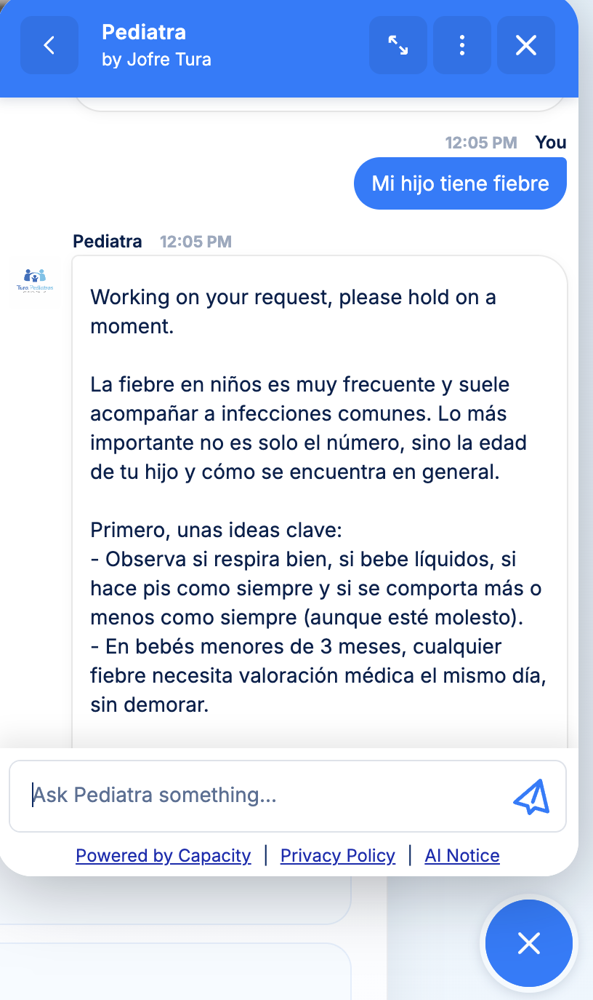
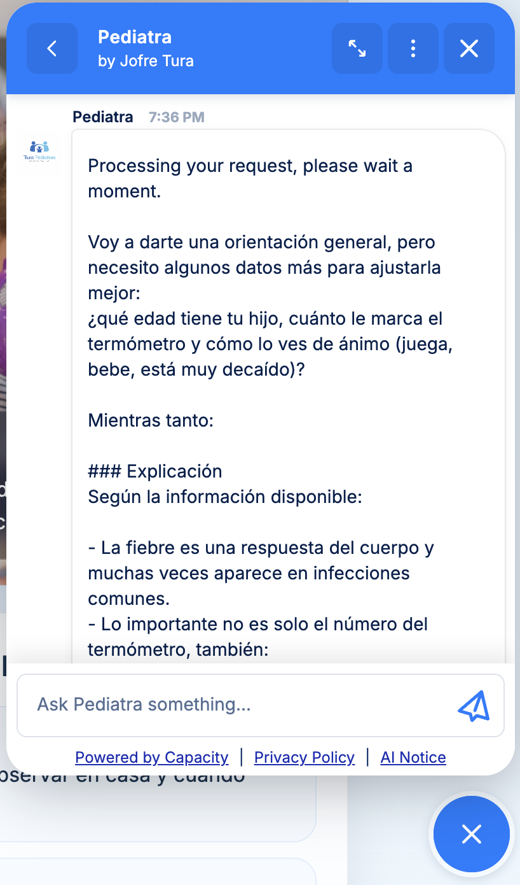

# Evaluation and recorded observations

The evidence comes from the April 2026 academic report. These are recorded classroom observations. Clinical validation and systematic performance measurement remain outstanding.

| Scenario | Input or method | Recorded observation | Evidence |
| --- | --- | --- | --- |
| Guided fever query | “Mi hijo tiene fiebre” | A Spanish answer was generated after the inquiry matched the configured exchange. | [Fever response](../assets/fever-response.png) |
| Outside-scope query | “Que pasa si una perro tiene fiebre?” | The assistant returned an insufficient-information response. | [Boundary test](../assets/out-of-scope.png) |
| Prompt refinement | The report describes repeating the fever question after changing the prompt. | The report concludes that the revised response was clearer and more concise and asked for relevant details earlier. | [Follow-up response sample](../assets/follow-up-response.png) and the academic write-up |
| Broad inquiry | “Mi bebé no está bien” | The report identifies that a broad message may miss the configured entry point. | Described in the academic write-up |

## Interpreting the screenshots

The captures show parts of the conversations. Their placement in the report does not establish a reliable before-and-after sequence. The response samples demonstrate different behaviours, while the claimed improvement remains the author's qualitative conclusion.

The visible samples also show an interface issue worth improving. English processing messages appear inside Spanish conversations, and one response displays a Markdown heading as literal text.

## What to measure next

- Record the exact prompt version, complete conversation and retrieved documents for each run.
- Test a fixed set of matched, unmatched and outside-scope inquiries.
- Review answer support against the retrieved material.
- Compare response length, follow-up placement and usefulness with explicit criteria.
- Check language consistency and formatting in the web widget.
- Add an appropriate domain review before considering a real health-information deployment.

## Response samples

### Fever query

### Follow-up questions

These images preserve the recorded application output and help explain the observations above.
